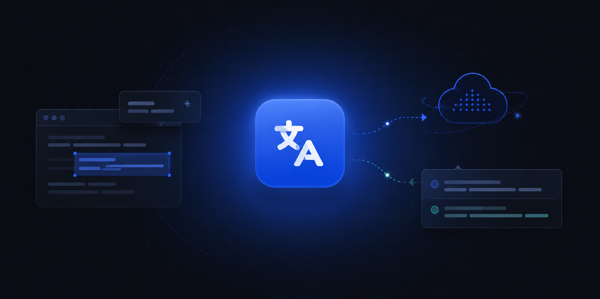

<h1 align="center">BrowserTranslate</h1>

<strong>Webseiten und Untertitel mit dem Modell deiner Wahl lesen.</strong> Open Source · Eigener API-Schlüssel · Kein Relay · Keine Telemetrie

  <a href="../README.md"><kbd>English</kbd></a>
  <a href="./zh-CN.md"><kbd>简体中文</kbd></a>
  <a href="./zh-TW.md"><kbd>繁體中文</kbd></a>
  <a href="./ja.md"><kbd>日本語</kbd></a>
  <a href="./ko.md"><kbd>한국어</kbd></a>
  <a href="./es.md"><kbd>Español</kbd></a>
  <a href="./fr.md"><kbd>Français</kbd></a> 
  <a href="./de.md"><kbd><b>Deutsch</b></kbd></a>
  <a href="./pt-BR.md"><kbd>Português (Brasil)</kbd></a>
  <a href="./it.md"><kbd>Italiano</kbd></a>
  <a href="./ru.md"><kbd>Русский</kbd></a>
  <a href="./tr.md"><kbd>Türkçe</kbd></a>
  <a href="./vi.md"><kbd>Tiếng Việt</kbd></a>
  <a href="./id.md"><kbd>Bahasa Indonesia</kbd></a>

  <a href="#installation">Installation</a> · <a href="#quick-start">Schnellstart</a> · <a href="./develop/README.md">Doku</a> · <a href="../CHANGELOG.md">Änderungen</a> · <a href="https://github.com/Lewen-Cai/browser-translate/issues">Issues</a>

  
  
  

  
  
  
  

## Warum BrowserTranslate?

- **Dein Modell, dein Schlüssel.** Verbinde eine Cloud-API, einen beliebigen OpenAI-kompatiblen Endpunkt oder eine lokale Laufzeitumgebung — oder starte mit den kostenlosen Diensten von Microsoft und Google, ganz ohne Schlüssel.
- **Direkt, ohne Relay.** Texte gehen aus deinem Browser direkt zum gewählten Anbieter. Das Projekt betreibt keinen Server und erhebt keine Telemetrie.
- **Fürs Lesen gemacht.** Markierter Text, ganze Seiten und Videountertitel — jeweils mit eigenem Anbieter und Modell.

## Funktionen

- **Auswahlkarte** — Text markieren und auf das Symbol klicken oder im Tastenkürzelmodus **Alt+T** drücken. Die Antwort wird in eine Karte gestreamt, die du anheften und verschieben kannst; kurze Auswahlen können einen Wörterbucheintrag erhalten.
- **Zweisprachige Webseiten** — Übersetzungen erscheinen beim Scrollen unter dem Original. Einschalten im Popup oder mit **Alt+A** im Tastenkürzelmodus.
- **Videountertitel** — zweisprachige Untertitel auf YouTube, in Zoom- und Canvas-Aufzeichnungen sowie in Standard-HTML5-Playern. Keine Audiotranskription.
- **Viele Anbieter, jeweils mehrere Modelle** — OpenAI, Claude, Gemini, DeepSeek, OpenRouter, Qwen und weitere, dazu LM Studio, Ollama und andere lokale Laufzeitumgebungen. Lege pro Anbieter mehrere Modelle an und wähle für jeden Modus eines aus.
- **Eigener Basis-Prompt** — den Standard ansehen und eigene Vorlagen schreiben.
- **56 Zielsprachen**, eine Oberfläche in **14 Sprachen**, helles und dunkles Design.

## Installation

Für **Chrome**, **Edge** und **Firefox** auf dem Desktop. Die Pakete gibt es unter [Releases](https://github.com/Lewen-Cai/browser-translate/releases); die Erweiterung steht in keinem Browser-Store. Brave, Arc und andere Chromium-Browser verwenden das Chrome-Paket. Safari wird nicht unterstützt.

### Chrome

1. Die neueste `…-chrome.zip` herunterladen und in einen Ordner entpacken, den du behältst.
2. `chrome://extensions` öffnen, den **Entwicklermodus** aktivieren, auf **Entpackte Erweiterung laden** klicken und den Ordner auswählen.

### Edge

Die neueste `…-edge.zip` herunterladen (derselbe Build wie das Chrome-Paket) und in einen dauerhaften Ordner entpacken. Dann `edge://extensions` öffnen, in der linken Seitenleiste den **Entwicklermodus** aktivieren, auf **Entpackte Erweiterung laden** klicken und den Ordner auswählen.

### Firefox

Ab Firefox 140. Die neueste `…-firefox.xpi` herunterladen — sie ist von Mozilla signiert —, in Firefox öffnen und bestätigen.

**Aktualisieren:** Auf der Einstellungsseite findet die Schaltfläche **Nach Updates suchen** das Paket für deinen Browser. Unter Chrome und Edge die neue Version über den alten Ordner entpacken und auf der Erweiterungsseite **Neu laden** drücken; unter Firefox die neue `.xpi` öffnen. Deine Einstellungen bleiben in beiden Fällen erhalten.

## Schnellstart

1. Direkt nach der Installation übersetzt die Erweiterung mit dem kostenlosen Dienst von Microsoft: Text auf einer Webseite markieren und auf das blaue Symbol klicken.
2. Für dein eigenes Modell im Popup auf das Einstellungssymbol klicken, **Anbieter** öffnen, einen Anbieter wählen und dessen API-Schlüssel einfügen. Die verfügbaren Modelle werden aufgelistet — füge die gewünschten hinzu und markiere eines mit einem Stern als Standard. Der Anbieter schaltet sich selbst ein.
3. Unter **Übersetzung → Übersetzungsdienste** für Auswahlkarten, ganze Seiten und Untertitel jeweils Anbieter und Modell festlegen.

Die Einstellungen gliedern sich in **Allgemein**, **Übersetzung**, **Anbieter**, **Untertitel** und **Daten**. Die [Bedienungsanleitung](./develop/usage.md) beschreibt jede Funktion im Detail.

## Datenschutz

Kein Relay-Server, keine Analyse, keine Remote-Protokolle. Der Text, den du übersetzt, geht nur an den gewählten Dienst. Einstellungen und API-Schlüssel bleiben im lokalen Erweiterungsspeicher des Browsers und sind **nicht verschlüsselt**. Die kostenlosen Optionen von Microsoft und Google nutzen inoffizielle öffentliche Endpunkte, ohne Verbindung zu den Unternehmen und ohne Gewährleistung — lies vor der Nutzung den [Hinweis](./develop/free-services.md).

## Dokumentation

Auf Englisch, unter [`readmes/develop/`](./develop/README.md):

- [Bedienungsanleitung](./develop/usage.md) — alle Funktionen, Anbieter und Modelle, Denksteuerung, Basis-Prompts
- [Kostenlose Übersetzungsdienste](./develop/free-services.md)
- [Architektur, Datenschutz und Antwortprüfung](./develop/architecture.md)
- [Aus dem Quellcode bauen](./develop/building.md) — `pnpm dev`, der Firefox-Build, Paketierung

Versionshinweise stehen im [Änderungsprotokoll](../CHANGELOG.md); Fehler und Wünsche gehören in die [Issues](https://github.com/Lewen-Cai/browser-translate/issues).

## Danksagung

- [read-frog](https://github.com/mengxi-ream/read-frog) — GPL-3.0; ein hervorragendes Projekt, von dem wir bei der Entwicklung dieser Erweiterung gelernt haben.
- [Lobe Icons](https://github.com/lobehub/lobe-icons) — MIT; Anbieterlogos, Symbole der Modellhersteller und die Tabelle, die Modelle ihnen zuordnet. Marken bleiben Eigentum ihrer Inhaber und kennzeichnen nur den gewählten Dienst.

## Lizenz

[GPL-3.0](../LICENSE). Verteilte abgeleitete Werke müssen die Pflichten zur Bereitstellung des Quellcodes und zur Lizenzierung erfüllen. Drittmaterial behält seine jeweiligen Lizenzen.
