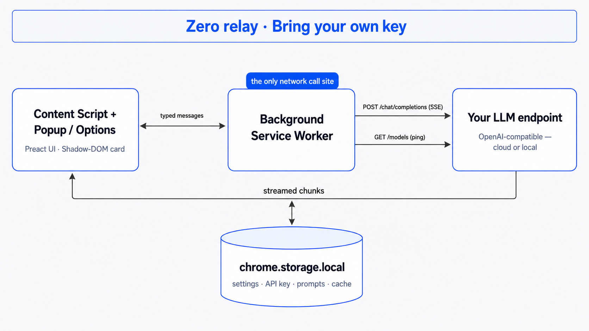

# Architecture, privacy and validation

[← Documentation](./README.md)

## Architecture

  

LLM and machine-translation requests run in the **extension's background script** (a service worker in Chrome and Edge, an event page in Firefox). Website JavaScript is not given your API key. Content scripts display results and integrate with pages/players; site-specific caption retrieval may also run in content or page context. There is no project-operated relay.

## Privacy and local data

The project operates no relay and collects no telemetry: no analytics, remote error reporting or remote logging. This does **not** mean all processing is local: cloud providers receive the text you ask them to translate, while a local runtime can keep model processing on your machine. Caption retrieval contacts the relevant video site. Manual update checks contact GitHub; services receive normal network metadata such as your IP address.

Settings, API keys and the translation cache are stored in the browser's extension storage (`chrome.storage.local`; Firefox's equivalent). **The extension does not encrypt API keys.** Settings exports omit keys by default; including them creates a plaintext file you must keep private. Cache is not exported. No browsable translation-history feature is maintained.

Firefox's install prompt declares that website content is sent elsewhere: that is the text you translate going to the service you selected, never to this project.

## Response validation

Obvious passages never receive dictionary-mode instructions. Short selections retain model choice, but dictionary entries must correspond to the entire selection, not one extracted word. Suspicious structured output is buffered and validated; the card receives an explicit result type instead of guessing from `{`.

An invalid selection response gets at most **one text-only correction request**. Invalid page/subtitle batches fall back to **one text-only request per uncached segment**. Corrections can cost extra tokens; transport retries are separate. Persistent format failures show an error rather than raw protocol JSON and are not cached.

Batch IDs must be complete and unique; results are restored to input order, and non-string values are rejected rather than coerced. Protocol-aware cache keys and cache-read validation isolate older unchecked LLM results. Literal structured source content can still be translated as text.

**Format validation cannot guarantee semantic accuracy or detect every omission.** Source-language labels are local display hints, including a conservative mixed-script label; they never block or route requests.
